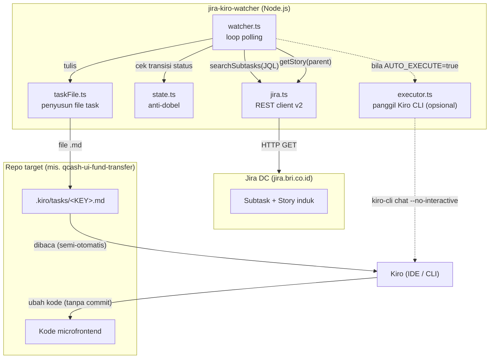
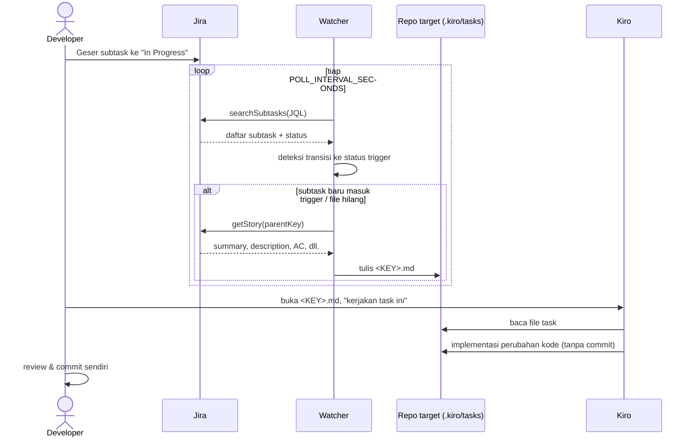
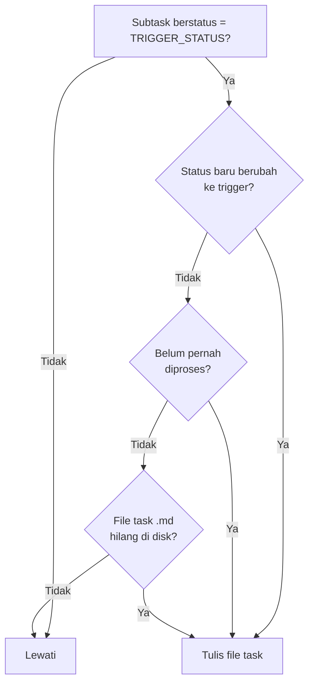

# Dokumentasi Teknis — Jira → Kiro Watcher

Dokumen ini menjelaskan secara detail arsitektur, alur kerja, konfigurasi, dan
keputusan desain dari **jira-kiro-watcher**: sebuah jembatan yang mengubah perubahan
status subtask di Jira menjadi instruksi kerja terstruktur untuk Kiro.

---

## Daftar Isi

1. [Ringkasan](#1-ringkasan)
2. [Masalah yang Diselesaikan](#2-masalah-yang-diselesaikan)
3. [Arsitektur](#3-arsitektur)
4. [Alur Data End-to-End](#4-alur-data-end-to-end)
5. [Struktur Proyek & Penjelasan Modul](#5-struktur-proyek--penjelasan-modul)
6. [Konfigurasi (.env)](#6-konfigurasi-env)
7. [Cara Menjalankan](#7-cara-menjalankan)
8. [Perintah Diagnostik](#8-perintah-diagnostik)
9. [Logika Anti-Dobel & Regenerasi](#9-logika-anti-dobel--regenerasi)
10. [Ekstraksi Data Jira](#10-ekstraksi-data-jira)
11. [Mode Eksekusi: Semi-Otomatis vs Otomatis](#11-mode-eksekusi-semi-otomatis-vs-otomatis)
12. [Keamanan](#12-keamanan)
13. [Troubleshooting](#13-troubleshooting)
14. [Keputusan Desain & Alasannya](#14-keputusan-desain--alasannya)
15. [Batasan yang Diketahui](#15-batasan-yang-diketahui)

---

## 1. Ringkasan

**jira-kiro-watcher** adalah program Node.js/TypeScript yang berjalan di latar belakang.
Ia memantau subtask di Jira (`jira.bri.co.id`) secara berkala (*polling*). Ketika sebuah
subtask digeser ke status pemicu (mis. **In Progress**), watcher mengambil konteks dari
Jira — judul subtask, deskripsi & acceptance criteria story induk — lalu menuliskannya
sebagai file Markdown terstruktur ke repo target di `.kiro/tasks/<SUBTASK-KEY>.md`.

File tersebut berfungsi sebagai **prompt siap-pakai** untuk Kiro. Developer membuka file
itu di Kiro IDE dan meminta Kiro mengerjakannya (mode semi-otomatis), atau — bila diaktifkan —
watcher memanggil Kiro CLI headless untuk mengeksekusinya (mode otomatis penuh).

Program **tidak pernah** melakukan commit atau push. Semua perubahan dibiarkan di working
directory untuk direview developer.

---

## 2. Masalah yang Diselesaikan

Dalam pengembangan microfrontend berbasis Jira, setiap kali memulai subtask developer harus:

- membuka Jira, membaca deskripsi story & acceptance criteria,
- menerjemahkannya menjadi konteks untuk asisten AI,
- menyalin-tempel manual ke prompt.

Langkah manual ini berulang, memakan waktu, dan rawan konteks yang tidak lengkap.
Watcher mengotomatiskan pengumpulan konteks: begitu subtask "dikerjakan" (digeser
statusnya), konteks Jira langsung tersedia sebagai file task terstruktur di repo.

---

## 3. Arsitektur

Sistem terdiri dari komponen-komponen kecil yang dapat diuji terpisah, disatukan oleh
sebuah loop polling.



**Prinsip desain:** watcher hanya bertanggung jawab menjembatani Jira → file task.
Eksekusi kode diserahkan ke Kiro. Pemisahan ini membuat setiap bagian sederhana dan
watcher tidak perlu tahu apa-apa soal isi repo target.

---

## 4. Alur Data End-to-End



---

## 5. Struktur Proyek & Penjelasan Modul

```
jira/
├─ src/
│  ├─ config.ts        # muat & validasi .env menjadi objek AppConfig
│  ├─ jira.ts          # client Jira REST v2 + ekstraksi field
│  ├─ state.ts         # penyimpan status (anti-dobel) di .state/
│  ├─ taskFile.ts      # susun konten & tulis file task .md
│  ├─ executor.ts      # panggil Kiro CLI headless (mode otomatis)
│  ├─ watcher.ts       # loop polling + orkestrasi semua modul
│  ├─ index.ts         # entrypoint watcher (npm run dev / start)
│  ├─ check.ts         # diagnostik koneksi & status (npm run check)
│  ├─ inspect.ts       # bedah field mentah sebuah issue
│  ├─ process-one.ts   # proses 1 subtask manual (uji)
│  └─ poll-once.ts     # jalankan 1 siklus polling lalu keluar (uji)
├─ docs/
│  ├─ DOCUMENTATION.md # dokumen ini
│  └─ PRESENTATION.md  # materi presentasi
├─ .env.example        # template konfigurasi
├─ README.md           # panduan cepat
├─ package.json
└─ tsconfig.json
```

### `config.ts`
Memuat `.env` via `dotenv`, memvalidasi variabel wajib, dan mengembalikan objek
`AppConfig` yang bertipe kuat. Nilai wajib yang kosong akan melempar error dengan pesan
yang jelas. Menyediakan `redact()` untuk menampilkan token secara aman di log.

### `jira.ts`
Client tipis untuk Jira Server/Data Center REST API v2. Bertanggung jawab atas:
- **Autentikasi**: header `Bearer <PAT>` (default) atau `Basic <user:pass>`.
- **`whoAmI()`**: verifikasi koneksi & kredensial (`/myself`).
- **`searchSubtasks(jql)`**: ambil subtask sesuai JQL (field: summary, status, issuetype, parent).
- **`getStory(key)`**: ambil detail story induk + ekstraksi description, acceptance criteria,
  story points, epic link, sprint, dan daftar subtask sibling.
- **`listProjects()`**: bantu menemukan project key (untuk diagnostik).
- Opsi **`JIRA_SKIP_SSL`** menggunakan `undici` Agent untuk menonaktifkan verifikasi TLS
  pada jaringan korporat dengan sertifikat self-signed.

### `state.ts`
`StateStore` menyimpan `lastKnownStatus` dan `lastProcessedAt` per subtask ke
`.state/watcher-state.json`. Ini mencegah watcher menulis file berulang setiap siklus
polling (lihat [bagian 9](#9-logika-anti-dobel--regenerasi)).

### `taskFile.ts`
Menyusun konten Markdown file task (`buildTaskContent`) dan menulisnya ke repo target
(`writeTaskFile`). Juga menyediakan `taskFilePathFor` dan `taskFileExists` untuk mendukung
logika regenerasi.

### `executor.ts`
Opsional. Bila `AUTO_EXECUTE=true`, memanggil `kiro-cli chat --no-interactive` di working
directory repo target. Mendukung autentikasi via sesi `kiro-cli login` (tanpa API key)
maupun `KIRO_API_KEY`.

### `watcher.ts`
Inti sistem. `pollOnce()` menjalankan satu siklus; `start()`/`stop()` mengelola timer
berkala. Mengorkestrasi: search subtask → deteksi transisi → ambil story → tulis file →
(opsional) eksekusi.

---

## 6. Konfigurasi (.env)

| Variabel | Wajib | Default | Keterangan |
|----------|:-----:|---------|------------|
| `JIRA_BASE_URL` | ✓ | — | URL Jira, mis. `https://jira.bri.co.id` |
| `JIRA_TOKEN` | ✓ | — | Personal Access Token (atau password bila `basic`) |
| `JIRA_USERNAME` | * | — | Wajib bila `JIRA_AUTH_TYPE=basic` |
| `JIRA_AUTH_TYPE` | | `bearer` | `bearer` (PAT) atau `basic` |
| `JIRA_SKIP_SSL` | | `false` | `true` untuk melewati verifikasi TLS |
| `JIRA_JQL` | ✓ | — | JQL pemilih subtask yang dipantau |
| `TRIGGER_STATUS` | ✓ | — | Nama status pemicu (case-sensitive) |
| `POLL_INTERVAL_SECONDS` | | `30` | Interval polling |
| `TARGET_REPO_PATH` | ✓ | — | Path absolut repo target |
| `TASK_OUTPUT_DIR` | | `.kiro/tasks` | Subfolder output file task |
| `AUTO_EXECUTE` | | `false` | `true` untuk panggil Kiro CLI otomatis |
| `KIRO_CLI_COMMAND` | | `kiro-cli` | Command Kiro CLI |
| `KIRO_TRUST_TOOLS` | | `all` | `all` atau daftar kategori (`read,write,grep`) |
| `KIRO_AGENT_ENGINE` | | — | `v1`/`v2`/`v3` (opsional) |
| `KIRO_API_KEY` | | — | Opsional; kosong bila sudah `kiro-cli login` |

Contoh JQL yang direkomendasikan (subtask milik sendiri saja):

```
project = NQLA AND issuetype = Sub-task AND assignee = currentUser()
```

---

## 7. Cara Menjalankan

```bash
# 1. Install dependency
npm install

# 2. Siapkan konfigurasi
cp .env.example .env      # lalu isi nilainya

# 3. Verifikasi koneksi dulu (disarankan)
npm run check

# 4. Jalankan watcher
npm run dev               # mode dev (tsx, tanpa build)
# atau
npm run build && npm start
```

Watcher berjalan terus sampai `Ctrl+C`.

---

## 8. Perintah Diagnostik

| Perintah | Fungsi |
|----------|--------|
| `npm run check` | Verifikasi auth, tampilkan subtask + status, cek kecocokan `TRIGGER_STATUS`. Bila JQL gagal, menampilkan daftar project agar mudah menemukan project key. |
| `npx tsx src/inspect.ts <KEY>` | Menampilkan semua field non-kosong sebuah issue (termasuk nama custom field). Berguna menemukan field Acceptance Criteria yang sebenarnya. |
| `npx tsx src/process-one.ts <KEY>` | Memproses satu subtask secara manual (menulis file task) tanpa menunggu polling. |
| `npx tsx src/poll-once.ts` | Menjalankan satu siklus polling lalu keluar. |

---

## 9. Logika Anti-Dobel & Regenerasi

Tanpa kontrol, watcher akan menulis file task setiap 30 detik selama status subtask
tetap di trigger. `StateStore` mencegah ini. Sebuah file task ditulis bila **salah satu**
kondisi berikut benar:



**Implikasi praktis:**
- Menggeser subtask keluar-lalu-masuk lagi ke status trigger → memicu penulisan ulang.
- **Menghapus file `.md`** sementara status masih di trigger → watcher meregenerasinya
  di siklus berikutnya. Ini cara mudah "memicu ulang" tanpa menyentuh Jira.
- Selama file ada dan status tak berubah → tidak ada penulisan berulang (tidak ada spam).

State disimpan di `.state/watcher-state.json` (di-ignore oleh git).

---

## 10. Ekstraksi Data Jira

Story di Jira BRI dapat menyimpan Acceptance Criteria di tempat berbeda. Ekstraksi
dilakukan *best-effort* dengan urutan:

1. **Custom field yang NAMANYA mengandung "acceptance"** — nama field diambil dari
   `/rest/api/2/field` (di-cache), lalu dicocokkan dengan id `customfield_*`.
2. **Fallback**: cari bagian di dalam `description` dengan heading "Acceptance Criteria".

Field tambahan yang juga diambil untuk memperkaya konteks: **Story Points**, **Epic Link**,
**Sprint**, dan **daftar subtask sibling** dalam story yang sama.

> Bila sebuah story tidak memiliki deskripsi/AC terisi di Jira, file task akan
> menandainya secara eksplisit (bukan gagal). Gunakan `inspect.ts` untuk memverifikasi
> di field mana sebenarnya data tersimpan.

---

## 11. Mode Eksekusi: Semi-Otomatis vs Otomatis

| Aspek | Semi-Otomatis (default) | Otomatis penuh |
|-------|-------------------------|----------------|
| `AUTO_EXECUTE` | `false` | `true` |
| Pemicu eksekusi | Developer buka file & minta Kiro | Watcher panggil Kiro CLI |
| Prasyarat tambahan | — | Kiro CLI terinstall + auth |
| Keandalan | Tinggi | Bergantung CLI & jaringan |
| Kontrol developer | Penuh (per task) | Otomatis |

**Catatan tentang Kiro Hook:** pendekatan awal memakai hook `PostFileCreate`. Ini
**tidak bekerja** karena — sesuai dokumentasi resmi Kiro — hook file hanya menyala untuk
file yang dibuat oleh agen Kiro sendiri, bukan oleh proses eksternal. Karena itu jalur
otomatis yang benar adalah watcher memanggil Kiro CLI (arah dibalik).

---

## 12. Keamanan

- **`.env` tidak di-commit** (masuk `.gitignore`). Token disimpan hanya lokal.
- Token di-**redaksi** saat ditampilkan di log (`redact()`).
- Bila token pernah terekspos (mis. tertempel di chat/log), **cabut dan buat PAT baru**
  di Jira.
- `JIRA_SKIP_SSL=true` hanya untuk jaringan korporat dengan sertifikat internal;
  jangan gunakan di jaringan yang tidak tepercaya.
- Program hanya melakukan operasi **baca** ke Jira dan **tulis file** ke repo target.
  Tidak ada operasi git yang dilakukan otomatis.

---

## 13. Troubleshooting

| Gejala | Kemungkinan penyebab | Solusi |
|--------|----------------------|--------|
| `Env "..." belum di-set` | `.env` belum dibuat/diisi | `cp .env.example .env` lalu isi |
| Gagal auth / timeout | Token salah, atau tidak di jaringan/VPN BRI | Cek PAT, sambungkan VPN, coba `JIRA_SKIP_SSL=true` |
| `400 ... does not exist for the field 'project'` | Project key salah di JQL | Jalankan `npm run check`, salin key yang benar dari daftar project |
| `TRIGGER_STATUS tidak cocok` | Nama status beda (case-sensitive) | Salin nama status persis dari output `check` |
| File task tidak muncul | Subtask tidak ada di hasil JQL / status bukan trigger / kepotong batas 100 | Persempit JQL, tambah `AND status = "..."` |
| AC/description kosong padahal ada di Jira | AC di custom field yang belum dikenali | `npx tsx src/inspect.ts <KEY>` untuk temukan field, sesuaikan `jira.ts` |
| Kiro tidak eksekusi otomatis | `AUTO_EXECUTE=false`, atau CLI belum ada | Gunakan semi-otomatis, atau install CLI + `kiro-cli login` |

---

## 14. Keputusan Desain & Alasannya

- **Polling, bukan webhook.** Webhook butuh akses admin Jira dan endpoint yang bisa
  dijangkau server Jira. Polling bekerja dari laptop biasa tanpa izin khusus. Trade-off:
  ada delay hingga satu interval.
- **File task sebagai antarmuka.** Menuliskan file `.md` menjadikan "kontrak" antara
  watcher dan Kiro sederhana, dapat diinspeksi manusia, dan versionable.
- **Tidak commit otomatis.** Menjaga developer tetap sebagai pengambil keputusan akhir;
  perubahan selalu direview sebelum masuk riwayat git.
- **State berbasis file.** Cukup untuk satu instance watcher; tidak perlu database.
- **Watcher = 1 repo target.** Sesuai kebutuhan "1 feature = 1 repo"; jalankan instance
  terpisah per repo microfrontend.

---

## 15. Batasan yang Diketahui

- **Delay polling**: perubahan status terdeteksi maksimal setelah satu interval (default 30s).
- **Batas 100 subtask** per query (`maxResults`). Bila subtask target tidak muncul,
  persempit JQL (mis. tambahkan filter status).
- **Ekstraksi AC best-effort**: bergantung pada penamaan field di instance Jira.
- **Eksekusi otomatis** memerlukan Kiro CLI + autentikasi yang mungkin terbatas di
  lingkungan korporat. Mode semi-otomatis tidak punya batasan ini.
- **Satu instance = satu repo**: memantau banyak repo butuh banyak instance.
